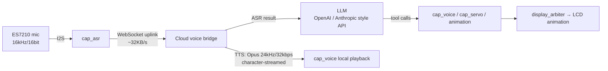

# Aili Edge Agent — On-Device AI Agent on ESP32-P4

> Author: **Jinghao Chang** ([@niNinNiNI](https://github.com/niNinNiNI))
> Built on top of **[espressif/esp-claw](https://github.com/espressif/esp-claw)** (Apache-2.0), Espressif's official open-source framework
> Timeline: May – Jun 2026 · **30 commits authored by me** in this repository

**In one line:** bringing cloud LLM capability down to a few-dollar MCU — this makes an ESP32-P4 **listen** (ES7210 mic → cloud ASR), **speak** (cloud TTS → local playback), **express emotion** (622 frames of character animation switched by conversation context) and **move** (servo), with the LLM driving all of it through tool calls.

<!-- ⬇️ TODO (author): replace with a 30s demo GIF (voice loop → emotion switch → servo) plus a board photo -->
| Demo placeholder | What it shows |
| --- | --- |
| `docs/demo/voice-loop.gif` | Voice loop: wake → cloud ASR → LLM → TTS playback |
| `docs/demo/emotion-switch.gif` | Emotion switching: conversation context → on-screen motion |
| `docs/demo/board.jpg` | ESP32-P4 WiFi6 Touch LCD 4.3 board |

---

## 1. What I built on top of upstream

> The framework core (`components/claw_*`, `components/lua_modules/`) **comes from upstream espressif/esp-claw**. Everything below is my own addition or modification, and each row is verifiable in this repository.

| Module | Scale | Location / notes |
| --- | --- | --- |
| **3 Capability modules** | ~3.3k lines of C | `components/claw_capabilities/cap_voice/` (TTS playback, 1,330 lines), `cap_servo/` (servo control, 1,333 lines incl. `motion.c`), `cap_asr/` (ES7210 capture, 609 lines) — exposed through the "register → discover → invoke" mechanism so the LLM drives them via JSON-Schema tool calls |
| **Custom video_player component** | 14 files / 4.3k lines | `application/edge_agent/components/video_player/`: `app_extractor.c` (1,266) · `video_player.c` (1,099) · `app_stream_adapter.c` (696) · `emotion_video_controller.c` (307) · `ppa_blend.c` (155) … MJPEG streaming, PPA hardware blending, display arbitration and stutter recovery |
| **Voice WebSocket common layer** | 3 files / 324 lines | `components/common/voice_ws_common/`: mic capture → WebSocket uplink → cloud ASR → LLM → TTS → local playback, event-routed |
| **Board & system adaptation** | 4 board targets | `application/edge_agent/boards/espressif/`: `esp32_p4_wifi6_touch_lcd_4_3`, `esp32_p4_eye`, `esp32_S3_DevKitC_1*`, `esp_box_3` and more; unified **8 / 16 / 32MB partition scheme** (`partitions_8MB.csv`, `partitions_16MB.csv`, `partitions_32MB.csv`) |
| **Character animation asset pipeline** | 10 motion sets / 622 frames | `Hiyori/` (m01–m10 Live2D motions) plus my `convert_to_mjpeg.sh` transcoding them to MJPEG for on-demand playback from a FATFS partition |
| **System & display fixes** | — | ST7701 panel mirroring fix + touchscreen enabled; PSRAM / NVS crash root-caused and fixed; playback stutter (display arbitration + recovery); playback stream decoupled from render path |
| **Chinese architecture docs** | 72 files / 18k lines | `ARCHITECTURE_CN.md` (2,695 lines), `语音模块架构文档.md` (1,858), `舵机控制代码架构文档.md` (1,014), `情绪切换系统架构文档.md` (751), `硬件显示架构.md` (674), `屏幕触摸按钮架构文档.md` (633), `PSRAM_NVS_CRASH_FIX.md`, `硬件镜像排查记录.md`, `Web管理界面架构文档.md` … |
| **Changes to upstream code** | 50 files / +604 / −209 | `app_capabilities.c`, `display_arbiter.c`, `app_claw/Kconfig`, `sdkconfig.defaults`, frontend `StatusBar.tsx`, etc. |

---

## 2. Four technical highlights

### 1. Capability layer — the LLM operates hardware directly
Three new Capability modules follow the upstream register/discover/invoke mechanism: each capability exposes itself as a tool with a JSON Schema, and the cloud LLM decides when to use the microphone, the speaker or the servo. **The voice pipeline is not hard-wired in firmware — the agent decides what to say and which animation to play.**

### 2. Presentation layer — video_player (MJPEG + PPA + display arbitration)
- **Why MJPEG instead of GIF / H.264:** on an MCU, JPEG benefits from PPA hardware assistance, decode cost is predictable and an 8-frame buffer pool keeps memory budgetable. GIF has poor palette quality and still burns CPU; H.264's decode complexity and licensing do not fit an MCU. On storage, MJPEG is read on demand from FATFS.
- **LVGL, video and animations all contending for the LCD:** solved with `display_arbiter` plus stutter recovery; the playback stream is decoupled from the render path so network jitter cannot interrupt playback.
- Emotion linkage: `emotion_video_controller.c` switches character animations based on conversation context (commits `30d07d66`, `a869b6b1`, `15cec9fc`).

### 3. Link layer — the on-device voice loop

- TX/RX and decoding are **decoupled by queues**, so network jitter does not interrupt playback;
- the voice path uses a **384KB PSRAM ring buffer** with **12 / 8 / 5KB tiered task stacks**, keeping scarce internal DRAM for the protocol stack and display;
- on cloud disconnect it reconnects with **exponential backoff** (1s → 2s → 4s … capped at 30s).

### 4. Board & system — a three-tier partition scheme and two hard debugging sessions
- The **8 / 16 / 32MB partition scheme** unified boards with different flash sizes, alongside 4 new board targets (commits `d9f3cf9a`, `01795ddc`, `2d908c04`, `8f875b26`);
- **PSRAM / NVS crash**: the investigation and root cause are documented in [`PSRAM_NVS_CRASH_FIX.md`](./application/edge_agent/PSRAM_NVS_CRASH_FIX.md) (commit `ff4edcaf`);
- **ST7701 panel mirroring + touchscreen**: see [`硬件镜像排查记录.md`](./application/edge_agent/硬件镜像排查记录.md) (commit `66f370e2`).

---

## 3. Repository layout (where my work lives)

```
application/edge_agent/
├── ARCHITECTURE_CN.md            # full architecture doc (2,695 lines)
├── components/video_player/      # mine: MJPEG playback / PPA blending / emotion controller
├── boards/espressif/             # board support (incl. esp32_p4_wifi6_touch_lcd_4_3)
├── docs/                         # DEV_WORKFLOW.md / ONBOARDING.md / voice_channel_plan.md
├── partitions_{8,16,32}MB.csv    # three-tier partition scheme
└── fatfs_image/                  # animation assets and Lua scripts
components/
├── claw_capabilities/cap_{voice,asr,servo}/   # mine: capability modules
└── common/voice_ws_common/                     # mine: voice WebSocket layer
Hiyori/                            # 10 Live2D motion sets (622 frames) + convert_to_mjpeg.sh
```

---

## 4. Build and flash

> The project is based on ESP-IDF targeting ESP32-P4. Install the toolchain following the upstream documentation first.

```bash
# 1) install and activate ESP-IDF (version noted in the root sdkconfig.defaults)
. $IDF_PATH/export.sh

# 2) select target and board
cd application/edge_agent
idf.py set-target esp32p4
idf.py menuconfig        # Board / Capability / partition table (8 / 16 / 32MB)

# 3) build, flash, monitor
idf.py build
idf.py -p <PORT> flash monitor
```

> For board configuration options and browser-based flashing, refer to the upstream docs at [esp-claw.com](https://esp-claw.com/). This repository only maintains its own board configs and application code.

---

## 5. Documentation index

| Document | Content |
| --- | --- |
| [`ARCHITECTURE_CN.md`](./application/edge_agent/ARCHITECTURE_CN.md) | Full module architecture (2,695 lines) |
| [`语音模块架构文档.md`](./application/edge_agent/语音模块架构文档.md) | Voice pipeline, buffers, task partitioning (1,858 lines) |
| [`舵机控制代码架构文档.md`](./application/edge_agent/舵机控制代码架构文档.md) | Servo capability implementation (1,014 lines) |
| [`情绪切换系统架构文档.md`](./application/edge_agent/情绪切换系统架构文档.md) | Emotion → motion mapping (751 lines) |
| [`硬件显示架构.md`](./application/edge_agent/硬件显示架构.md) / [`屏幕触摸按钮架构文档.md`](./application/edge_agent/屏幕触摸按钮架构文档.md) | Display and touch (674 / 633 lines) |
| [`PSRAM_NVS_CRASH_FIX.md`](./application/edge_agent/PSRAM_NVS_CRASH_FIX.md) / [`硬件镜像排查记录.md`](./application/edge_agent/硬件镜像排查记录.md) | Two key debugging records |
| [`docs/DEV_WORKFLOW.md`](./application/edge_agent/docs/DEV_WORKFLOW.md) | Development workflow (867 lines) |

---

## 6. Metrics — measured vs. not yet measured

To avoid overstating anything, here is the exact status of each number:

| Metric | Value | Basis |
| --- | --- | --- |
| Voice uplink bandwidth | ~32 KB/s | Design parameter (16kHz / 16bit / mono) |
| TTS output | Opus 24kHz / 32kbps, character-streamed | Design parameter |
| Voice ring buffer / task stacks | 384KB PSRAM / 12+8+5KB | Design parameter (voice architecture doc) |
| Cloud reconnect backoff | 1s → capped at 30s | Design parameter |
| End-to-end voice latency (mean / P95) | **not yet measured** | No instrumented run yet |
| Firmware flash / RAM footprint (`idf.py size`) | **not yet measured** | Not exported yet |

> A related peripheral project (ESP32-P4 USB secondary display) does have one measured figure: frame rate improved from **15fps to 30fps** (see the `usb_800x480_RGBLCD` repository).

---

## 7. Relationship to upstream & acknowledgements

- **Upstream:** this project is a derivative work built on Espressif's official open-source framework [espressif/esp-claw](https://github.com/espressif/esp-claw) (Apache-2.0). The framework core (Agent Runtime, event routing, `components/claw_*`, `components/lua_modules/`) is **upstream's implementation and copyright**; my additions are listed in section 1.
- **License:** Apache-2.0, see [LICENSE](./LICENSE).
- **Acknowledgements:** the upstream framework is open-sourced by Espressif Systems; ESP-Claw's Agent Loop and IM communication draw on [OpenClaw](https://github.com/openclaw/openclaw) and [memovai/mimiclaw](https://github.com/memovai/mimiclaw).
