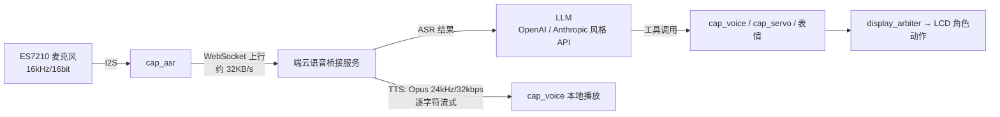

# 爱莉 Edge Agent · 端侧 AI 智能体（ESP32-P4）

> 作者：**常景皓**（GitHub [@niNinNiNI](https://github.com/niNinNiNI)）
> 形态：在 **乐鑫官方开源框架 [espressif/esp-claw](https://github.com/espressif/esp-claw)**（Apache-2.0）之上做二次开发
> 周期：2026.05 – 2026.06 · 本仓库我本人提交 **30 次**

**一句话**：把云端大模型能力落到几美元 MCU 上——让一块 ESP32-P4 能**听**（ES7210 麦克风 → 云端 ASR）、能**说**（云端 TTS → 本地播放）、有**表情**（622 帧角色动作按对话语境切换）、能**动**（舵机），并且这套能力由 LLM 通过工具调用直接驱动。

<!-- ⬇️ TODO（本人补）：录 30 秒演示（语音对话 → 情绪动作切换 → 舵机动作）后换成 GIF，并加一张板子实物照 -->
| 演示占位 | 说明 |
| --- | --- |
| `docs/demo/voice-loop.gif` | 语音闭环：唤醒 → 云端 ASR → LLM → TTS 回放 |
| `docs/demo/emotion-switch.gif` | 情绪动作切换：对话语境 → 画面动作联动 |
| `docs/demo/board.jpg` | ESP32-P4 WiFi6 Touch LCD 4.3 实机照 |

---

## 一、我在上游之上做了什么

> 框架核心（`components/claw_*`、`components/lua_modules/`）**来自上游 espressif/esp-claw**；下表是我新增与修改的部分，每一行都能在仓库里点开验证。

| 模块 | 规模 | 代码位置 / 说明 |
| --- | --- | --- |
| **3 个 Capability 能力模块** | 约 3.3k 行 C | `components/claw_capabilities/cap_voice/`（TTS 播放 1,330 行）、`cap_servo/`（舵机控制 1,333 行，含 `motion.c`）、`cap_asr/`（ES7210 采集 609 行）——经"能力注册→发现→调用"机制由 LLM 以 JSON Schema 工具调用直接驱动 |
| **自研 video_player 组件** | 14 文件 / 4.3k 行 | `application/edge_agent/components/video_player/`：`app_extractor.c`(1,266) · `video_player.c`(1,099) · `app_stream_adapter.c`(696) · `emotion_video_controller.c`(307) · `ppa_blend.c`(155) … 实现 MJPEG 流式播放、PPA 硬件混合、显示仲裁与卡顿自恢复 |
| **语音 WebSocket 公共层** | 3 文件 / 324 行 | `components/common/voice_ws_common/`：麦克风采集 → WebSocket 上行 → 云端 ASR → LLM → TTS → 本地播放，事件路由驱动 |
| **板级与系统适配** | 4 套板卡 | `application/edge_agent/boards/espressif/`：`esp32_p4_wifi6_touch_lcd_4_3`、`esp32_p4_eye`、`esp32_S3_DevKitC_1*`、`esp_box_3` 等；统一 **8 / 16 / 32MB 三级分区规范**（`partitions_8MB.csv`、`partitions_16MB.csv`、`partitions_32MB.csv`） |
| **角色表现资产管线** | 10 组动作 / 622 帧 | `Hiyori/`（m01–m10 Live2D 动作）+ 自研 `convert_to_mjpeg.sh` 转码为 MJPEG 落入 FATFS 分区按需播放 || **系统与显示修复** | — | ST7701 面板镜像修复并启用触摸屏、PSRAM / NVS 崩溃定位与修复、播放卡顿（display 仲裁 + 卡顿自恢复）、显示流与渲染路径解耦 |
| **中文架构文档** | 72 文件 / 18k 行 | `ARCHITECTURE_CN.md`(2,695 行)、`语音模块架构文档.md`(1,858)、`舵机控制代码架构文档.md`(1,014)、`情绪切换系统架构文档.md`(751)、`硬件显示架构.md`(674)、`屏幕触摸按钮架构文档.md`(633)、`PSRAM_NVS_CRASH_FIX.md`、`硬件镜像排查记录.md`、`Web管理界面架构文档.md` … |
| **对上游代码的修改** | 50 文件 / +604 / −209 | `app_capabilities.c`、`display_arbiter.c`、`app_claw/Kconfig`、`sdkconfig.defaults`、前端 `StatusBar.tsx` 等 |

---

## 二、四个技术亮点

### 1. 能力层：让 LLM 直接操作硬件
新增三个 Capability 模块，遵循上游"能力注册—发现—调用"机制：每个能力把自己暴露成带 JSON Schema 的工具，云端 LLM 决定何时调用麦克风、扬声器、舵机。**不是把语音链路写死在固件里，而是让 Agent 自己决定说什么、做什么表情。**

### 2. 表现层：video_player（MJPEG + PPA + 显示仲裁）
- **为什么用 MJPEG 而不是 GIF / H.264**：MCU 侧 JPEG 有 PPA 硬件辅助、解码开销可控、8 帧帧缓冲池内存可预算；GIF 调色板质量差且同样吃 CPU，H.264 的解码复杂度与授权不适合 MCU。存储侧 MJPEG 落 FATFS 按需读取。
- **LVGL、视频、表情三方抢 LCD 的问题**：用 `display_arbiter` 做仲裁，并实现卡顿自恢复；把播放流与渲染路径解耦，避免网络抖动直接打断播放。
- 情绪联动：`emotion_video_controller.c` 按对话语境自动切换角色动作（相关提交：`30d07d66`、`a869b6b1`、`15cec9fc`）。

### 3. 链路层：端侧语音闭环

- 收发与解码用**队列解耦**，网络抖动不会直接打断播放；
- 语音链路使用 **384KB PSRAM 环形缓冲** + **12 / 8 / 5KB 分级任务栈**，把稀缺的内部 DRAM 留给协议栈与显示；
- 云端断开后按**指数退避重连**（1s → 2s → 4s … 上限 30s）。

### 4. 板级与系统：三级分区规范 + 两次硬骨头调试
- **8 / 16 / 32MB 三级分区规范**统一了不同 Flash 容量的板卡，新增 4 套板卡适配（提交 `d9f3cf9a`、`01795ddc`、`2d908c04`、`8f875b26`）；
- **PSRAM / NVS 崩溃**：定位过程与根因记录在 [`PSRAM_NVS_CRASH_FIX.md`](./application/edge_agent/PSRAM_NVS_CRASH_FIX.md)（提交 `ff4edcaf`）；
- **ST7701 面板镜像 + 触摸屏**：见 [`硬件镜像排查记录.md`](./application/edge_agent/硬件镜像排查记录.md)（提交 `66f370e2`）。

---

## 三、仓库结构（我改动/新增的部分集中在这些目录）

```
application/edge_agent/
├── ARCHITECTURE_CN.md            # 全模块架构文档（2,695 行）
├── components/video_player/      # 自研：MJPEG 播放 / PPA 混合 / 情绪视频控制器
├── boards/espressif/             # 板级适配（含 esp32_p4_wifi6_touch_lcd_4_3）
├── docs/                         # DEV_WORKFLOW.md / ONBOARDING.md / voice_channel_plan.md
├── partitions_{8,16,32}MB.csv    # 三级分区方案
└── fatfs_image/                  # 角色动作资产与 Lua 脚本
components/
├── claw_capabilities/cap_{voice,asr,servo}/   # 自研能力模块
└── common/voice_ws_common/                     # 语音 WebSocket 公共层
Hiyori/                            # 10 组 Live2D 动作（622 帧）+ convert_to_mjpeg.sh
```

---

## 四、编译与烧录

> 工程基于 ESP-IDF（ESP32-P4 目标）。首次编译前请按上游文档安装工具链。

```bash
# 1) 安装并激活 ESP-IDF（版本见项目根 sdkconfig.defaults 注释）
. $IDF_PATH/export.sh

# 2) 选择目标芯片与板卡
cd application/edge_agent
idf.py set-target esp32p4
idf.py menuconfig        # Board / Capability / 分区表在此选择（8 / 16 / 32MB）

# 3) 编译、烧录、监视
idf.py build
idf.py -p <PORT> flash monitor
```

> 具体板卡配置项与在线烧录方式以上游文档为准：[esp-claw.com](https://esp-claw.com/)（本仓库只维护自己的板级配置与业务代码）。

---

## 五、文档索引

| 文档 | 内容 |
| --- | --- |
| [`ARCHITECTURE_CN.md`](./application/edge_agent/ARCHITECTURE_CN.md) | 全模块架构（2,695 行） |
| [`语音模块架构文档.md`](./application/edge_agent/语音模块架构文档.md) | 语音链路、缓冲与任务划分（1,858 行） |
| [`舵机控制代码架构文档.md`](./application/edge_agent/舵机控制代码架构文档.md) | 舵机能力实现（1,014 行） |
| [`情绪切换系统架构文档.md`](./application/edge_agent/情绪切换系统架构文档.md) | 情绪 → 动作映射（751 行） |
| [`硬件显示架构.md`](./application/edge_agent/硬件显示架构.md) / [`屏幕触摸按钮架构文档.md`](./application/edge_agent/屏幕触摸按钮架构文档.md) | 显示与触摸（674 / 633 行） |
| [`PSRAM_NVS_CRASH_FIX.md`](./application/edge_agent/PSRAM_NVS_CRASH_FIX.md) / [`硬件镜像排查记录.md`](./application/edge_agent/硬件镜像排查记录.md) | 两次关键调试记录 |
| [`docs/DEV_WORKFLOW.md`](./application/edge_agent/docs/DEV_WORKFLOW.md) | 开发工作流（867 行） |

---

## 六、指标说明（哪些是实测、哪些还没测）

为避免夸大，这里把口径写清楚：

| 指标 | 数值 | 口径 |
| --- | --- | --- |
| 语音上行带宽 | 约 32 KB/s | 设计参数（16kHz / 16bit / 单声道） |
| TTS 输出 | Opus 24kHz / 32kbps，逐字符流式 | 设计参数 |
| 语音环形缓冲 / 任务栈 | 384KB PSRAM / 12+8+5KB | 设计参数（见语音模块架构文档） |
| 云端重连退避 | 1s → 上限 30s | 设计参数 |
| 端到端语音延迟（均值 / P95） | **待补测** | 尚未打点实测 |
| 固件 Flash / RAM 占用（`idf.py size`） | **待补测** | 尚未导出 |

> 相关外设项目（ESP32-P4 USB 外扩副屏）另有一处实测：投屏帧率 **15fps → 30fps**（见 `usb_800x480_RGBLCD` 仓库）。

---

## 七、与上游的关系与致谢

- **上游**：本项目基于乐鑫官方开源框架 [espressif/esp-claw](https://github.com/espressif/esp-claw)（Apache-2.0）二次开发。框架核心（Agent Runtime、事件路由、`components/claw_*`、`components/lua_modules/`）**版权与实现均属上游**；本仓库的增量如第一节表格所列。
- **许可证**：沿用 Apache-2.0，见 [LICENSE](./LICENSE)。
- **致谢**：上游框架由乐鑫（Espressif Systems）开源；ESP-Claw 的 Agent Loop / IM 通信等实现参考了 [OpenClaw](https://github.com/openclaw/openclaw) 与 [memovai/mimiclaw](https://github.com/memovai/mimiclaw)。
